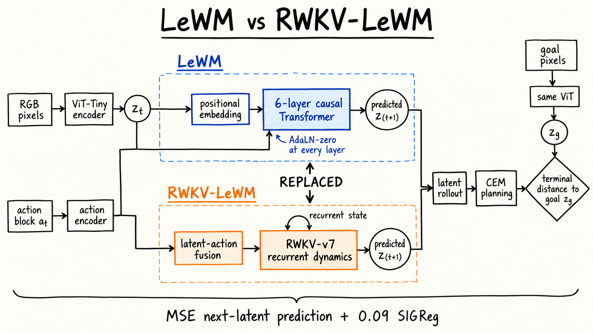
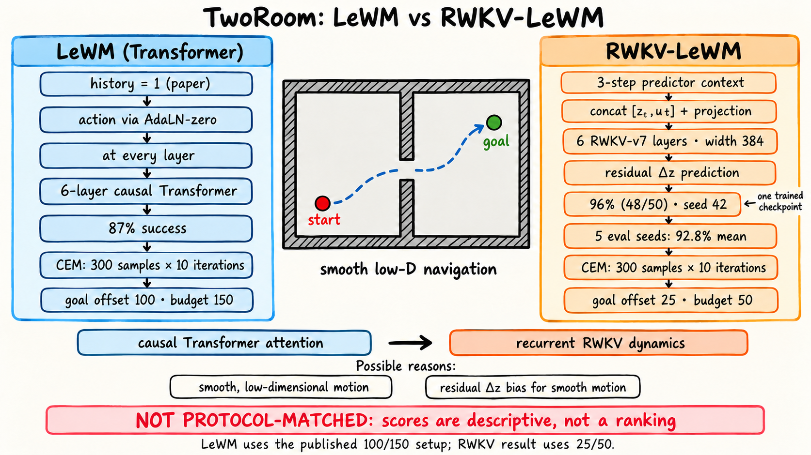
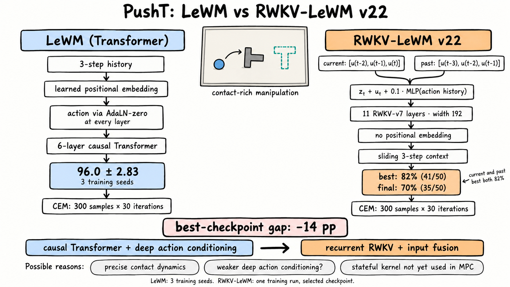

# RWKV-LeWM

RWKV-LeWM is a research implementation of a pixel-based latent world model. It
keeps the end-to-end visual representation learning, SIGReg regularization, and
latent-space planning interface of
[LeWorldModel (LeWM)](https://github.com/lucas-maes/le-wm), while replacing its
trajectory Transformer with an RWKV-v7 dynamics model.

The project asks a concrete question: can recurrent RWKV dynamics retain LeWM's
planning quality while eventually providing linear-time sequence processing and
a fixed-size rollout state instead of a growing Transformer KV cache?

> [!IMPORTANT]
> This is an experimental research codebase, not an official LeWM or RWKV
> release. The current CUDA adapter trains with RWKV-v7 sequence kernels, but
> MPC evaluation still re-runs the latest three-token context at each predicted
> step. A true stateful O(1)-memory rollout kernel remains future work.

## Project goals

- Preserve LeWM's compact, end-to-end latent planning pipeline.
- Study RWKV-v7 as the temporal dynamics backbone for visual world models.
- Compare action-conditioning and action-fusion designs under a fixed LeWM
  training and MPC evaluation protocol.
- Reproduce results on TwoRoom and improve action-sensitive planning on PushT.

The repository currently contains complete training and evaluation paths for
TwoRoom and PushT. Download support is also provided for the official LeWM Cube
and Reacher datasets, but no RWKV-LeWM results are reported for those tasks yet.

## Architecture at a glance



Both models encode the current and goal images with the same ViT-style visual
front end, predict future states in latent space, and use CEM to minimize the
terminal distance to the goal latent. The central replacement is the temporal
predictor: LeWM uses a causal Transformer with learned positions and layer-wise
AdaLN-zero action conditioning, whereas this project uses RWKV-v7 recurrence
with task-specific action fusion. The loss remains next-latent MSE plus `0.09`
SIGReg.

## Method

### Core world model

Each RGB observation is encoded into one compact latent token, and each block
of environment actions is encoded into the same latent width:

```text
z_t = normalize(Projector(ViT(pixels_t)))
u_t = ActionEncoder(action_block_t)
x_t = Fuse(z_t, u_t, recent_actions)
z_hat_{t+1} = PredictionHead(RWKV-v7(x_{<=t}))
```

The model is trained end-to-end from pixels. The ViT is initialized from
scratch; no pretrained visual features or proprioceptive inputs are used by the
world model. Proprioceptive/state columns are loaded only by the environment
evaluation machinery to initialize simulator states and goals.

The current PushT configuration (`v22`) is:

| Component | Configuration |
| --- | --- |
| Image encoder | ViT, 224x224 input, 14x14 patches, width 192, 12 layers, 3 heads |
| Latent projector | 2048-hidden MLP with BatchNorm, output width 192 |
| Action input | 5 raw 2-D actions concatenated into one 10-D action block |
| Action encoder | LeWM-compatible Conv1d + SiLU MLP, output width 192 |
| Dynamics | 11 RWKV-v7 blocks, width 192, head size 64, FFN width 2048 |
| Prediction head | LeWM-style 2048-hidden MLP, direct next-latent prediction |
| Positional encoding | None; temporal order is handled by RWKV recurrence |
| Backend | Vendored RWKV-v7 CUDA sequence kernels; PyTorch fallback for debugging |

### Current v22 action-history fusion

The strongest current PushT model augments the stable additive input path with
a small causal summary of recent action embeddings:

```text
x_t = z_t + u_t + alpha * MLP([u_{t-k+1}, ..., u_t])
```

The history branch uses three action blocks, has a zero-initialized output, and
starts with scalar `alpha = 0.1`. Two variants are included:

- `current`: summarizes `[u_{t-2}, u_{t-1}, u_t]`.
- `past`: summarizes `[u_{t-3}, u_{t-2}, u_{t-1}]`, so the current action is
  not duplicated in the history branch.

The corresponding configs are
`pusht_rwkv_v22_actionhist_{current,past}_{stage1,stage2}_ds.yaml`.

### Task-specific adaptations and Transformer replacement

The experiments are not a pure one-line backbone swap. Context handling,
action fusion, predictor depth/width, and prediction head also differ, so the
measured gaps cannot be attributed to RWKV alone.

#### TwoRoom



| Design choice | Official LeWM | RWKV-LeWM TwoRoom |
| --- | --- | --- |
| Temporal predictor | 6-layer causal Transformer | 6 RWKV-v7 blocks, width 384 |
| Temporal context | History length 1 in the paper | Trained on 4-step sequences; rollout retains up to 3 tokens |
| Action conditioning | AdaLN-zero at every Transformer layer | Concatenate latent and encoded action, then project once |
| Position signal | Learned positional embedding | No absolute positional embedding; order comes from recurrence |
| Output | Transformer prediction projector | Residual delta, `z_hat_next = z + delta_z` |

This variant is aimed at smooth navigation: recurrence carries short-term
motion through the doorway, while residual prediction biases the dynamics
toward small latent changes.

#### PushT



| Design choice | Official LeWM | RWKV-LeWM PushT v22 |
| --- | --- | --- |
| Temporal predictor | 6-layer causal Transformer | 11 RWKV-v7 blocks, width 192 |
| Temporal context | History length 3 | Sliding 3-token context |
| Action conditioning | AdaLN-zero at every Transformer layer | Add current action at the input plus a zero-initialized 3-action history branch |
| Position signal | Learned positional embedding | None |
| Output | LeWM prediction projector | Same style of projector, direct next-latent prediction |

For v22, `alpha` in the history branch is trainable and initialized to `0.1`.
The `current` and `past` variants test whether duplicating the present action in
that branch helps contact-sensitive dynamics.

### Objective

Training uses four model steps: three context steps and one prediction step.
The model makes dense next-latent predictions over the context, and targets are
detached to prevent the predictor from changing the target branch directly:

```text
L = mean(||z_hat_{t+1} - stopgrad(z_{t+1})||^2)
    + 0.09 * SIGReg(z)
```

SIGReg uses 17 knots and 1,024 random projections to keep the learned latent
distribution from collapsing.

### Latent MPC planning

At evaluation time, the current and goal images are encoded once. Cross-Entropy
Method (CEM) planning samples action sequences, rolls each candidate forward in
latent space, and minimizes terminal latent distance:

```text
cost(actions) = ||z_hat_H(actions) - z_goal||^2
```

All evaluations use 300 candidates, top-30 elite selection, a five-step model
horizon, and five raw actions per action block. Following the paper, TwoRoom
uses 10 CEM refinement steps and PushT uses 30. PushT is compared at goal
offset 25 and budget 50 on both sides. The available RWKV-LeWM TwoRoom run uses
offset 25 and budget 50, whereas the paper reports offset 100 and budget 150;
that result is therefore not protocol-matched.

## Data

The loaders use the official LeWM HDF5 datasets hosted on Hugging Face. Data is
stored outside this repository under `$STABLEWM_HOME`.

| Name | Hugging Face dataset | Expected file | Compressed size | Used here |
| --- | --- | --- | ---: | --- |
| PushT | [`quentinll/lewm-pusht`](https://huggingface.co/datasets/quentinll/lewm-pusht) | `pusht_expert_train.h5` | 13.1 GB | Yes |
| TwoRoom | [`quentinll/lewm-tworooms`](https://huggingface.co/datasets/quentinll/lewm-tworooms) | `tworoom.h5` | 3.43 GB | Yes |
| OGBench Cube | [`quentinll/lewm-cube`](https://huggingface.co/datasets/quentinll/lewm-cube) | `cube_single_expert.h5` | 46.2 GB | Download only |
| Reacher | [`quentinll/lewm-reacher`](https://huggingface.co/datasets/quentinll/lewm-reacher) | `reacher.h5` | 23.8 GB | Download only |

For the reported TwoRoom and PushT runs:

```text
pixels: (batch, 4, 3, 224, 224)
action: (batch, 4, 10)  # raw action dim 2 x frameskip 5
```

The non-image columns (`action`, `proprio`, and, for PushT, `state`) are
standardized with statistics computed from the dataset. Images are normalized
with ImageNet statistics.

Download and extract data with:

```bash
export STABLEWM_HOME=/path/to/stable-wm-data

python scripts/download_lewm_data.py tworoom --output "$STABLEWM_HOME"
python scripts/download_lewm_data.py pusht --output "$STABLEWM_HOME"
```

`zstd` and `tar` must be installed on the host. Downloading all four archives
requires roughly 86.5 GB before extraction.

## Installation

The package requires Python 3.12 or newer. The default backend requires Linux,
an NVIDIA GPU, a working CUDA toolchain, and `ninja` to compile the custom
RWKV-v7 operator.

```bash
uv venv --python=3.12
source .venv/bin/activate
uv pip install -e '.[dev,swm]'
uv pip install deepspeed
```

Run the lightweight CPU test with the PyTorch fallback backend:

```bash
pytest -q
python scripts/smoke_test.py --device cpu --backend fallback
```

Validate the default CUDA backend with:

```bash
python scripts/smoke_test.py --device cuda --backend rwkv7_cuda
```

## Training

Hydra configs live in `config/train/`. The main entry points are `train.py` for
single-process experiments and `train_deepspeed.py` for distributed training.

### Current PushT v22 training

The reported runs use four GPUs with DeepSpeed ZeRO-2 and bfloat16. The
per-GPU batch size is 32, giving a global batch size of 128. Optimization uses
AdamW with learning rate `5e-5`, weight decay `1e-3`, betas `(0.9, 0.95)`, and
gradient clipping at 1.0.

Stage 1 trains for two epochs. Stage 2 resumes the complete DeepSpeed state from
`epoch_2` and trains for ten more epochs. Run either v22 variant with:

```bash
export STABLEWM_HOME=/path/to/stable-wm-data

# Train both stages, then evaluate epochs 1, 2, 3, 4, 8, 9, and 10.
bash scripts/train_eval_pusht_rwkv_v22.sh current all
bash scripts/train_eval_pusht_rwkv_v22.sh past all
```

The second argument can be `stage1`, `stage2`, or `eval` to run only one part.
Additional Hydra overrides may be appended after it.

### TwoRoom training

The TwoRoom run uses the official dataset and training-scale settings: four
GPUs, DeepSpeed ZeRO-2, global batch size 128, two warm-up epochs, and an
eight-epoch continuation:

```bash
export STABLEWM_HOME=/path/to/stable-wm-data
bash scripts/train_tworoom_deepspeed_zero2.sh all

bash eval_tworoom.sh outputs/tworoom_stage2_ds/epoch_8
```

## Results

### Comparison with official LeWM

The official reference values come from the
[LeWM paper](https://arxiv.org/abs/2603.19312) and its
[official implementation](https://github.com/lucas-maes/le-wm). Both sides use
50 evaluation episodes, horizon 5, action block 5, 300 CEM candidates, and
top-k 30. Task-specific settings and reporting differences are shown rather
than hidden:

| Task and reporting point | LeWM paper protocol | Official LeWM | RWKV-LeWM protocol | RWKV-LeWM | Nominal difference |
| --- | --- | ---: | --- | ---: | ---: |
| TwoRoom, seed 42 reference | Offset 100, budget 150, CEM 10 | 87% | Offset 25, budget 50, CEM 10 | **96% (48/50)**, epoch 7 | +9 pp† |
| TwoRoom, five RWKV evaluation seeds | Same published reference | 87% | Offset 25, budget 50, CEM 10 | **92.8% mean**, range 90–96% | +5.8 pp† |
| PushT, best selected checkpoint | Offset 25, budget 50, CEM 30 | **96.0 ± 2.83%** | Offset 25, budget 50, CEM 30 | 82% (41/50) | **−14 pp** |
| PushT, final epoch 10 | Offset 25, budget 50, CEM 30 | **96.0 ± 2.83%** | Offset 25, budget 50, CEM 30 | 70% (35/50) | **−26 pp** |

† The TwoRoom percentages are deliberately shown because they are the only
available results, but they are **not a matched ranking**: the goal distance
and control budget differ. No claim that RWKV-LeWM outperforms LeWM on
TwoRoom should be inferred from the nominal percentage difference.

The TwoRoom sweep varies evaluation/CEM seeds `0–4` on one trained epoch-7
checkpoint; it is not five independent training seeds. Its individual rates
are 92%, 96%, 96%, 90%, and 90%. The paper reports one 87% TwoRoom value. For
PushT, LeWM reports a mean over three training seeds evaluated on the same 50
trajectories, whereas RWKV-LeWM has one training run and a selected checkpoint.

For completeness, the TwoRoom stage-2 epoch-8 checkpoint scored 92% (46/50)
under the local offset-25/budget-50 setup with 30 CEM iterations. At epoch 7,
raising CEM from 10 to 30 iterations did not improve the five-evaluation-seed
mean (92.8% versus 91.6%). These are useful robustness checks within the local
protocol, not substitutes for the missing offset-100/budget-150 evaluation.

### Interpreting the differences

**TwoRoom.** The present numbers cannot isolate an architecture effect because
the evaluation tasks differ: the paper samples the goal 100 steps ahead with a
150-step budget, while the local result uses 25 and 50. Architectural changes
also move together. RWKV-LeWM uses up to three context tokens rather than the
paper's history length of one, and its residual delta head is a natural bias
for smooth, low-dimensional motion. The LeWM paper additionally notes that the
dataset's low diversity and intrinsic dimensionality may make SIGReg's
high-dimensional isotropic Gaussian target harder to match. These are
hypotheses to test after running the same offset-100/budget-150 evaluation, not
explanations established by the current percentages.

**PushT.** The −14 pp best-checkpoint gap suggests that the current replacement
is less effective on contact-rich, action-sensitive dynamics. LeWM injects the
action through AdaLN-zero at every Transformer layer, while v22 fuses it mainly
at the RWKV input with a small history branch. LeWM also gives causal attention
explicit access to three position-embedded tokens; v22 depends on recurrence
without absolute positions. Finally, MPC currently recomputes a sliding
three-token window instead of carrying a true RWKV recurrent state, so it does
not yet realize the intended stateful rollout advantage. The drop from 82% at
the selected checkpoint to 70% at epoch 10 further indicates training and
checkpoint-selection instability.

The clean next experiment is therefore a controlled ablation that keeps LeWM's
history, action conditioning, predictor width, and prediction head fixed while
changing only the Transformer/RWKV temporal mixer, followed by multiple
independent training seeds.

### RWKV-LeWM development history

The two v22 action-history variants reached the same best score: `current` at
stage 2 epoch 9 and `past` at stage 2 epoch 8, both 82% (41/50). Both final
epoch-10 checkpoints scored 70% (35/50).

Selected PushT development milestones under the same evaluation protocol:

| Version | Main change | Best measured success rate |
| --- | --- | ---: |
| v17 | Additive `z_t + u_t`, no absolute position embedding | 80% |
| v20 | Learned additive action scale | 80% |
| v21 | Per-channel scaled action injection | 80% |
| v22 | Causal three-block action-history summary | **82%** |

These development numbers are checkpoint-selection results from one evaluation
seed, not confidence intervals or multi-seed averages. Checkpoints, raw logs,
datasets, and `outputs/` are intentionally excluded from Git because they are
large.

## Repository layout

```text
config/                         Hydra train/eval and DeepSpeed configs
assets/architecture/            Hand-drawn model and task comparison diagrams
src/rwkv_lewm/                  Model, losses, encoders, and dynamics backends
src/rwkv_lewm/backends/         Vendored RWKV-v7 model implementation
scripts/                        Data, training, evaluation, and diagnostics
tests/                          CPU smoke test
third_party/rwkv_v7_reference/  Upstream RWKV-v7 training reference
train.py                        Single-process trainer
train_deepspeed.py              Four-GPU DeepSpeed trainer
```

## Known limitations

- PushT has one RWKV-LeWM training run; independent training-seed statistics
  comparable to LeWM's three-seed result are still needed.
- The TwoRoom five-seed number varies evaluation randomness for one checkpoint,
  not training randomness.
- The CUDA backend currently exposes sequence-oriented kernels. MPC keeps a
  three-token sliding context instead of using a true one-step recurrent kernel.
- Only TwoRoom and PushT have completed result tables.
- No pretrained weights or datasets are distributed in this repository.
- The implementation is optimized for the local four-GPU research workflow;
  other CUDA/toolchain combinations may require adjustment.

## Acknowledgements

This project builds on the official
[LeWorldModel paper](https://arxiv.org/abs/2603.19312) and
[code and protocol](https://github.com/lucas-maes/le-wm),
[stable-worldmodel](https://github.com/galilai-group/stable-worldmodel),
[stable-pretraining](https://github.com/galilai-group/stable-pretraining), and
the official [RWKV-v7 implementation](https://github.com/BlinkDL/RWKV-LM/tree/main/RWKV-v7).

Please cite the upstream projects when using this code in research.
